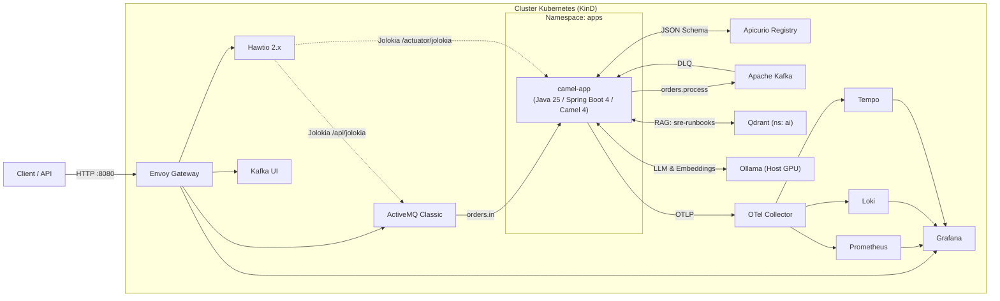

# 🐪 Camel Cloud Native

Plateforme d'intégration événementielle **Cloud Native** déployée en **GitOps** sur Kubernetes, combinant **Apache Camel 4**, **ActiveMQ Classic**, **Apache Kafka**, **Apicurio Registry**, une stack d'observabilité complète (**OpenTelemetry**, **LGTM**, **Hawtio**) et une **remédiation automatique de Dead Letter Queue (DLQ)** pilotée par IA locale (**Ollama** + **Qdrant RAG**).

---

## 🎯 Capacités clés

* **Intégration résiliente** : ActiveMQ Classic (`orders.in`) → Apache Camel 4 → Apache Kafka (`orders.process`) avec validation de contrat JSON Schema via **Apicurio Registry**.
* **DLQ intelligente & Auto-remédiation (RAG + Guardrails)** : Analyse des messages en échec par **Ollama** (`llama3.1:8b` + `nomic-embed-text`), enrichie par une base vectorielle **Qdrant** (`sre-runbooks`) et encadrée par un garde-fou métier (`AiRemediationGuard`, limite de retries).
* **Observabilité 360°** :
  * **Logs, Métriques & Traces** : OpenTelemetry Collector → **Loki**, **Prometheus**, **Tempo**, **Grafana**.
  * **Exploitation JMX / Camel** : **Hawtio 2.x** connecté via proxy à ActiveMQ et à `camel-app` (**Jolokia 2** sur Spring Boot 4, `BacklogTracer` et `BacklogDebugger` en mode *standby*).
* **Cloud Native & Scalabilité** : Provisioning **Terraform** (KinD), routage **Envoy Gateway**, déploiement continu **ArgoCD**, autoscaling événementiel **KEDA** (`ScaledObject`) et gestion sécurisée des secrets via **Sealed Secrets**.
* **DevSecOps** : Pipeline GitHub Actions bloquant (tests Camel `AdviceWith`, `helm lint`, `terraform validate`, scan **Trivy** IaC & conteneur non-root avant publication sur GHCR).

---

## 🏗️ Architecture globale



### Routes Apache Camel (`camel-lab-context`)

| Classe | Rôle |
| :--- | :--- |
| **`OrderActiveMqRoute`** | Consomme `activemq6:queue:orders.in` et publie les commandes vers Kafka (`orders.process`). |
| **`OrderKafkaRoute`** | Consomme `orders.process`, valide le contrat via `OrderContractService` (Apicurio / `order-schema.json`) et route les erreurs vers la DLQ. |
| **`DlqAiAnalyzerRoute`** | Analyse les messages en DLQ via **Qdrant** (runbooks SRE) + **Ollama**, puis applique `AiRemediationGuard` pour décider d'une remédiation/rejeu sécurisé. |

---

## 🧰 Stack technique

| Domaine | Technologies |
| :--- | :--- |
| **Application** | Java 25 (Temurin), Spring Boot 4.1.2, Apache Camel 4, Maven |
| **Messaging & Contrats** | ActiveMQ Classic, Apache Kafka, Kafka UI, Apicurio Registry |
| **IA & RAG** | Ollama (`llama3.1:8b`, `nomic-embed-text`), Qdrant (`sre-runbooks`) |
| **Infrastructure & GitOps** | KinD, Terraform (`infra/terraform`), Envoy Gateway, ArgoCD, Helm, KEDA, Sealed Secrets |
| **Observabilité** | OpenTelemetry Collector, Prometheus, Loki, Tempo, Grafana, Hawtio 2.x, Jolokia 2.1.2 |
| **CI/CD & Sécurité** | GitHub Actions, GHCR, Trivy (IaC + Container), image Docker non-root |

---

## 📁 Structure du dépôt

```text
camel-cloud-native/
├── .github/workflows/
│   └── ci.yml                          # Pipeline CI/CD (Java, Helm, Terraform, Trivy, GHCR)
├── app/                                # Application Spring Boot 4 / Apache Camel 4
│   ├── Dockerfile                      # Image multi-stage durcie (non-root)
│   ├── pom.xml                         # Dépendances Camel 4, Jolokia 2, tests
│   └── src/
│       ├── main/java/com/lab/camel/
│       │   ├── config/                 # JolokiaConfig, OllamaConfig, RagConfig
│       │   ├── contract/               # OrderContractService, SchemaValidationException
│       │   ├── model/                  # Order
│       │   ├── rag/                    # RunbookSeeder (initialisation Qdrant)
│       │   ├── remediation/            # AiRemediationDecision, AiRemediationGuard
│       │   └── route/                  # OrderActiveMqRoute, OrderKafkaRoute, DlqAiAnalyzerRoute
│       ├── main/resources/
│       │   ├── application.yml         # Configuration Camel, Ollama, Qdrant, Apicurio, OTel
│       │   ├── logback-spring.xml      # Logs JSON structurés
│       │   └── schemas/order-schema.json
│       └── test/java/com/lab/camel/    # Tests unitaires & Camel AdviceWith
├── charts/camel-app/                   # Chart Helm applicatif
│   ├── Chart.yaml
│   ├── values.yaml
│   └── templates/                      # deployment, service, scaledobject (KEDA), sealed-secret
├── gitops/                             # Manifestes synchronisés par ArgoCD
│   ├── ai/                             # qdrant.yaml
│   ├── argocd/                         # apps.yaml (App of Apps)
│   ├── gateway/                        # gateway.yaml, routes.yaml, hawtio-route.yaml
│   ├── messaging/                      # activemq, apicurio-registry, hawtio, kafka-cluster, kafka-topics, kafka-ui
│   └── observability/                  # grafana, loki, otel-collector, prometheus, tempo
└── infra/
    ├── main.tf
    └── terraform/                      # cluster.tf, platform.tf, variables.tf, outputs.tf, versions.tf
```

---

## 🚀 Démarrage rapide (Local)

### Prérequis

* **Docker Desktop**, **KinD**, **kubectl**, **Helm**, **Terraform**
* **JDK 25** & **Maven** (pour exécuter les tests en local)
* **Ollama** sur la machine hôte avec les modèles `llama3.1:8b` et `nomic-embed-text`

### 1. Provisionner le cluster et la plateforme

```powershell
cd infra/terraform
terraform init
terraform apply -auto-approve
```

### 2. Vérifier la synchronisation ArgoCD

```powershell
kubectl get applications -n argocd
kubectl get pods -A
```

---

## 🔍 Exploitation & Observabilité (Hawtio)

Hawtio est accessible via Envoy Gateway sur **`http://hawtio.localhost:8080/hawtio/`**.

### Connexions Jolokia (`proxyAllowlist`)

Dans **Connect** → **Add connection** :

| Nom | Host | Port | Path | Authentification |
| :--- | :--- | :--- | :--- | :--- |
| **ActiveMQ Local** | `activemq.messaging.svc.cluster.local` | `8161` | `/api/jolokia` | `admin` / `admin` |
| **Camel App** | `camel-app.apps.svc.cluster.local` | `8080` | `/actuator/jolokia` | Aucune (local) |

### Outils actifs sur `camel-app`

* **Jolokia 2 sur Spring Boot 4** : exposé via `JolokiaConfig` (`AgentServlet` + `jolokia-service-serializer` + `jolokia-service-jmx`).
* **Route Diagram** : visualisation temps réel des routes et compteurs d'échanges.
* **Trace (`BacklogTracer`)** & **Debug (`BacklogDebugger`)** : activés en mode *standby* (`backlog-tracing-standby: true` et `camel.debug.standby: true`) pour tracer ou poser des breakpoints sans surcoût hors session.

### Tester un flux de bout en bout

```powershell
# Envoyer un message de test dans ActiveMQ (orders.in)
curl.exe -u admin:admin -X POST "[http://activemq.localhost:8080/api/message/orders.in?type=queue](http://activemq.localhost:8080/api/message/orders.in?type=queue)" `
  -d 'body={"orderId":"TEST-001","amount":42.50,"status":"NEW"}'

# Vérifier l'agent Jolokia de camel-app via le proxy Hawtio
curl.exe -s [http://hawtio.localhost:8080/hawtio/proxy/http/camel-app.apps.svc.cluster.local:8080/actuator/jolokia/version](http://hawtio.localhost:8080/hawtio/proxy/http/camel-app.apps.svc.cluster.local:8080/actuator/jolokia/version)
```

---

## 🔄 Pipeline CI/CD (`.github/workflows/ci.yml`)

Chaque `push` ou `pull_request` sur `main` exécute 4 jobs :

1. **`java-build-and-test`** : JDK 25 (Temurin), `mvn test -B` (tests unitaires & Camel `AdviceWith`).
2. **`helm-and-security-audit`** : `helm lint`, `helm template` et scan **Trivy** IaC sur `charts/camel-app` (bloquant sur `HIGH,CRITICAL`).
3. **`terraform-validate`** : `terraform fmt -check -recursive`, `terraform init -backend=false` et `terraform validate` dans `infra/terraform`.
4. **`docker-build-and-publish`** *(après succès des 3 jobs)* : build de l'image durcie (`:main` et `:sha-<commit>`), scan **Trivy** bloquant (`CRITICAL`), puis publication sur **GHCR** (`ghcr.io/kvolte-dev/camel-app`).

Pour déployer immédiatement une nouvelle image `:main` dans KinD :

```powershell
kubectl rollout restart deployment/camel-app -n apps
kubectl rollout status deployment/camel-app -n apps
```

---

## ⚙️ Variables d'environnement principales (`application.yml`)

| Variable | Défaut | Description |
| :--- | :--- | :--- |
| `ACTIVEMQ_URL` | `tcp://localhost:61616` | URL du broker ActiveMQ Classic |
| `KAFKA_BROKERS` | `localhost:9092` | Bootstrap servers Kafka |
| `APICURIO_URL` | `http://localhost:8080/apis/ccompat/v7` | URL Apicurio Schema Registry |
| `OLLAMA_URL` / `OLLAMA_MODEL` | `http://localhost:11434` / `llama3.1:8b` | Endpoint et modèle LLM Ollama |
| `QDRANT_HOST` / `QDRANT_COLLECTION` | `localhost` / `sre-runbooks` | Base vectorielle RAG |
| `AI_REMEDIATION_ENABLED` / `MAX_RETRIES` | `true` / `1` | Activation et garde-fou de remédiation IA |
| `OTEL_ENABLED` | `false` | Active l'export OTLP (traces, métriques, logs) |

---

## 👤 Auteur

Développé par **Pierre** ([`@Kvolte-dev`](https://github.com/Kvolte-dev)).