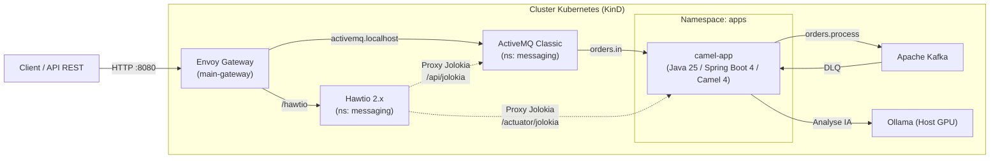

# 🐪 Camel Cloud Native

Architecture d'intégration événementielle **Cloud Native** déployée en **GitOps** sur Kubernetes, combinant **Apache Camel 4**, **ActiveMQ Classic**, **Apache Kafka**, **Hawtio**, **Envoy Gateway** et une analyse intelligente des **Dead Letter Queues (DLQ)** assistée par IA locale (Ollama + RAG).

---

## 🎯 Objectifs du projet

* Démontrer une chaîne d'intégration moderne et résiliente (ActiveMQ → Apache Camel → Kafka) sur Kubernetes.
* Automatiser le provisioning d'infrastructure avec **Terraform** et le déploiement continu avec **ArgoCD**.
* Garantir un haut niveau d'**observabilité** (métriques Prometheus/Grafana, logs JSON structurés, inspection JMX/Jolokia, traçage et débogage pas-à-pas des routes via **Hawtio**).
* Appliquer les bonnes pratiques **DevSecOps** (conteneurs non-root, scan de vulnérabilités **Trivy** en CI/CD).
* Enrichir le traitement des erreurs métier/techniques (DLQ) via un analyseur IA local (**Ollama** + **Qdrant RAG**).

---

## 🏗️ Architecture globale



### Flux des routes Apache Camel (`camel-lab-context`)

| Route ID | Source | Destination / Rôle |
| :--- | :--- | :--- |
| **`activemq-orders-in-route`** | `activemq6:queue:orders.in` | Consomme les commandes entrantes, enrichit/valide le payload et publie sur `kafka:orders.process`. |
| **`kafka-orders-process-route`** | `kafka:orders.process` | Traite les commandes et gère les exceptions (`onException`) avec routage vers la DLQ en cas d'échec. |
| **`kafka-dlq-ai-analyzer-route`** | Topic DLQ Kafka | Intercepte les messages en échec, sollicite le modèle IA local pour diagnostiquer la cause racine et router l'action corrective. |

---

## 🧰 Stack technique

| Domaine | Technologies |
| :--- | :--- |
| **Application** | Java 25, Spring Boot 4.1.2, Apache Camel 4, Maven |
| **Messaging** | ActiveMQ Classic (`61616` / `8161`), Apache Kafka |
| **Infrastructure** | KinD (Kubernetes in Docker), Terraform, Envoy Gateway |
| **GitOps & CI/CD** | ArgoCD, GitHub Actions, GHCR (`ghcr.io/kvolte-dev/camel-app`) |
| **Observabilité** | Hawtio 2.x, Jolokia 2.1.2 (`AgentServlet`), Spring Boot Actuator, Prometheus, Grafana |
| **Sécurité** | Trivy (scan d'images), exécution non-root (`appuser`) |
| **IA / RAG** | Ollama (GPU local), Qdrant *(Chantier 3)* |

---

## 📁 Structure du dépôt

```text
camel-cloud-native/
├── app/                                # Code source Java / Spring Boot / Apache Camel
│   ├── src/main/java/com/lab/camel/
│   │   ├── CamelLabApplication.java    # Point d'entrée Spring Boot
│   │   ├── config/
│   │   │   └── JolokiaConfig.java      # Exposition Servlet Jolokia 2 (/actuator/jolokia/*)
│   │   └── routes/                     # Définition des routes Camel (ActiveMQ, Kafka, DLQ IA)
│   ├── src/main/resources/
│   │   └── application.yml             # Config Camel, JMX, BacklogTracer & BacklogDebugger
│   ├── Dockerfile                      # Build multi-stage durci (non-root)
│   └── pom.xml                         # Dépendances Spring Boot 4, Camel 4, Jolokia 2
├── charts/
│   └── camel-app/                      # Chart Helm de l'application
├── gitops/                             # Manifestes Kubernetes gérés par ArgoCD
│   ├── messaging/
│   │   ├── activemq.yaml               # Déploiement & Service ActiveMQ Classic
│   │   └── hawtio.yaml                 # Console Hawtio 2.x + proxyAllowlist + HTTPRoute
│   └── ...
├── infra/                              # Scripts Terraform (cluster KinD, Envoy Gateway, ArgoCD)
└── .github/workflows/                  # Pipeline CI/CD (Build, Test, Trivy, Push GHCR)
```

---

## 🚀 Démarrage rapide (Environnement local)

### Prérequis

* **Docker Desktop** (ou moteur Docker compatible KinD)
* **KinD**, **kubectl**, **Helm**, **Terraform**
* **JDK 25** & **Maven 3.9+** (pour les builds locaux)
* **PowerShell** (Windows) ou Bash

### 1. Provisionner l'infrastructure (Terraform)

```powershell
cd infra
terraform init
terraform apply -auto-approve
```

Cette étape crée le cluster KinD, installe **Envoy Gateway** (`main-gateway`) et déploie **ArgoCD** pointant sur ce dépôt Git.

### 2. Vérifier la synchronisation ArgoCD

```powershell
kubectl get applications -n argocd
kubectl get pods -n messaging
kubectl get pods -n apps
```

Tous les pods (`activemq`, `hawtio`, `camel-app`) doivent être en état `Running` (`1/1`).

---

## 🔍 Exploitation & Observabilité avec Hawtio

Hawtio est exposé via Envoy Gateway sur **`http://hawtio.localhost:8080/hawtio/`**.

### Connexions pré-autorisées (`proxyAllowlist`)

Dans l'onglet **Connect** → **Add connection** de Hawtio :

| Cible | Host | Port | Path | Authentification |
| :--- | :--- | :--- | :--- | :--- |
| **ActiveMQ Local** | `activemq.messaging.svc.cluster.local` | `8161` | `/api/jolokia` | `admin` / `admin` |
| **Camel App** | `camel-app.apps.svc.cluster.local` | `8080` | `/actuator/jolokia` | Aucune (local) |

### Fonctionnalités activées sur `camel-app`

* **JMX & Jolokia 2 (compatible Spring Boot 4)** : exposé via `JolokiaConfig` (`jolokia-server-core` + `jolokia-service-serializer` + `jolokia-service-jmx`) sans dépendre de `hawtio-springboot`.
* **Route Diagram** : visualisation graphique des routes et compteurs d'échanges en temps réel.
* **Trace (`BacklogTracer`)** : activé en mode *standby* (`camel.springboot.backlog-tracing-standby: true`) pour inspecter les headers et payloads à chaque étape sans impact sur les performances hors session.
* **Debug (`BacklogDebugger`)** : activé en mode *standby* (`camel.debug.standby: true`) via `camel-debug-starter` pour poser des breakpoints directement sur les nœuds des routes.

### Tester un flux de bout en bout

Envoyer un message de test dans la queue `orders.in` :

```powershell
curl.exe -u admin:admin -X POST "[http://activemq.localhost:8080/api/message/orders.in?type=queue](http://activemq.localhost:8080/api/message/orders.in?type=queue)" `
  -d 'body={"orderId":"TEST-001","amount":42.50,"status":"NEW"}'
```

Vérifier la santé de l'endpoint Jolokia via le proxy Hawtio :

```powershell
curl.exe -s [http://hawtio.localhost:8080/hawtio/proxy/http/camel-app.apps.svc.cluster.local:8080/actuator/jolokia/version](http://hawtio.localhost:8080/hawtio/proxy/http/camel-app.apps.svc.cluster.local:8080/actuator/jolokia/version)
```

---

## 🔄 Workflow CI/CD & GitOps

1. Chaque `git push` sur `main` déclenche **GitHub Actions** :
   * Compilation et tests Maven (`mvn test-compile`).
   * Build de l'image Docker multi-stage non-root.
   * Analyse de sécurité **Trivy**.
   * Publication sur **GHCR** (`ghcr.io/kvolte-dev/camel-app:main`).
2. **ArgoCD** synchronise automatiquement les manifestes du dossier `gitops/`.
3. Pour forcer le téléchargement d'une nouvelle image applicative sur le tag `main` :

```powershell
kubectl rollout restart deployment/camel-app -n apps
kubectl rollout status deployment/camel-app -n apps
```

---

## 🗺️ Roadmap & Chantiers

- [x] **Chantier 1 — Socle Cloud Native & GitOps** : KinD, Terraform, Envoy Gateway, ArgoCD, ActiveMQ, Kafka, `camel-app`.
- [x] **Chantier 2 — Sécurité & Durcissement** : Scan Trivy en CI/CD, exécution non-root (`appuser`) des conteneurs.
- [x] **Observabilité avancée** : Hawtio 2.x, Jolokia 2 sur Spring Boot 4, `BacklogTracer` (Trace) et `BacklogDebugger` (Debug).
- [ ] **Chantier 3 — RAG & IA sur la DLQ** : Déploiement de **Qdrant** dans Kubernetes et enrichissement de l'analyse IA des erreurs DLQ avec **Ollama** (base de connaissances d'incidents et runbooks).

---

## 👤 Auteur

Développé par **Pierre** ([`@kvolte-dev`](https://github.com/kvolte-dev)).